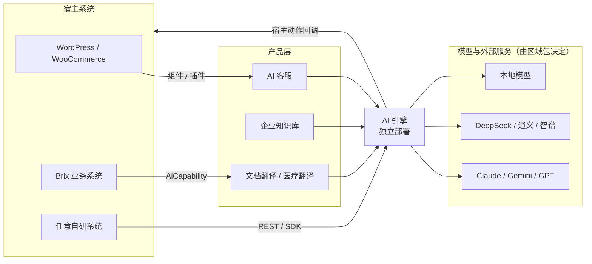
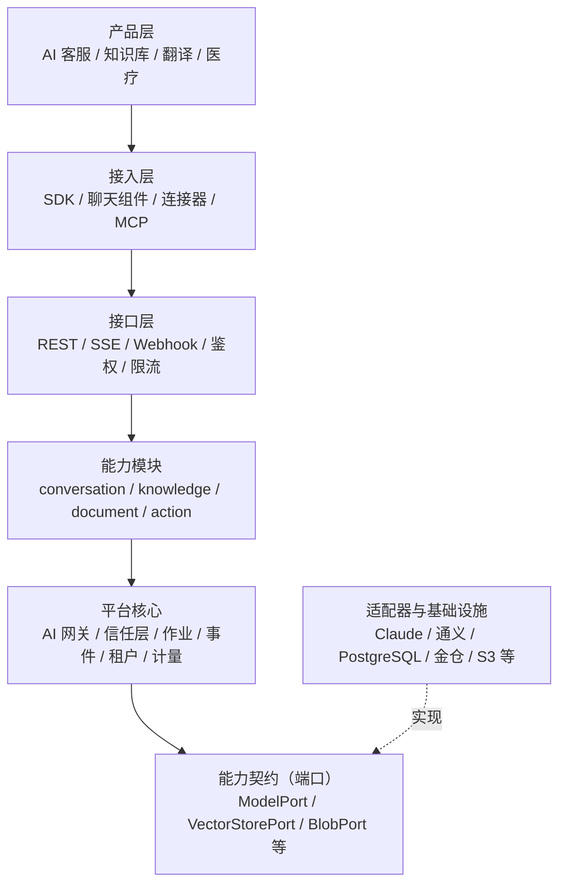
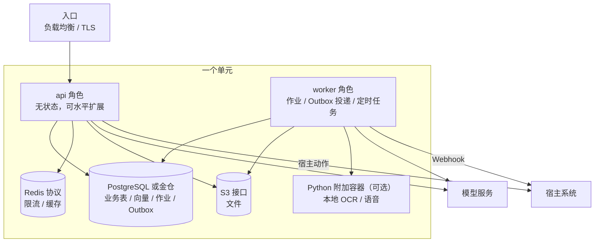
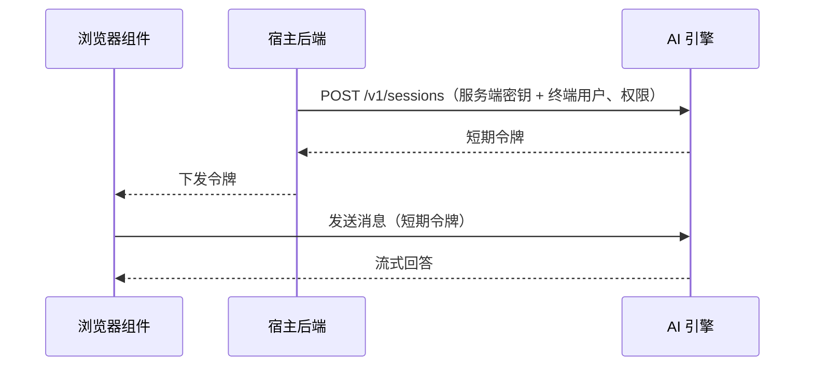
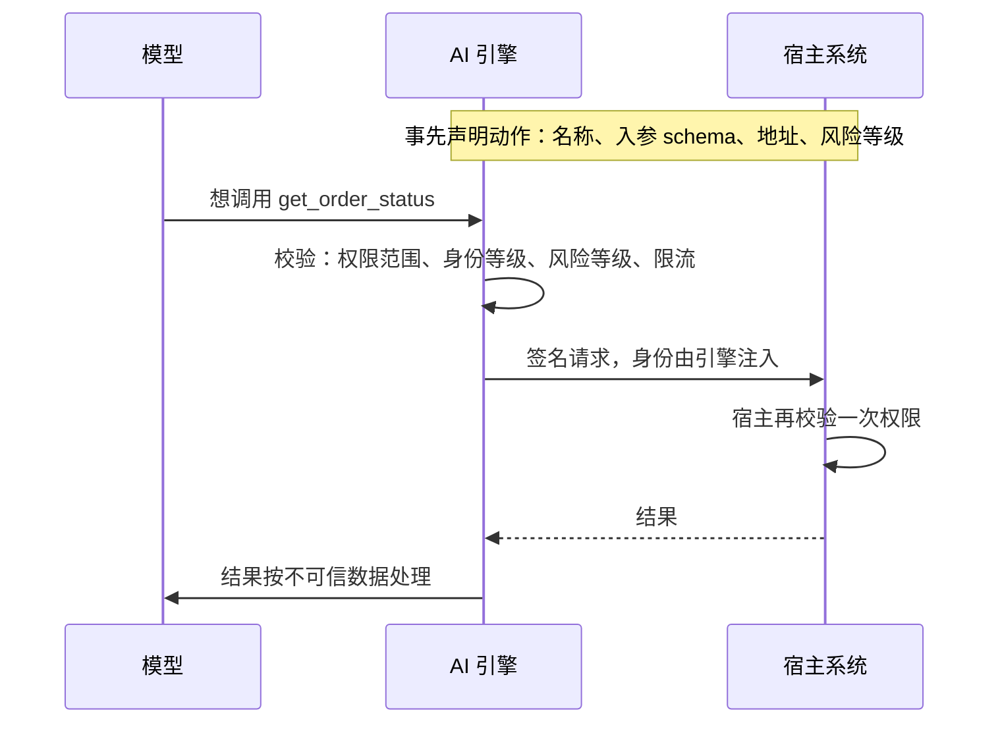
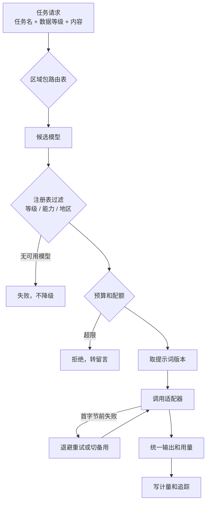
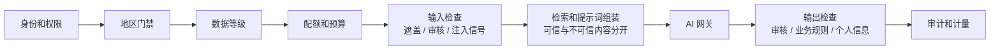
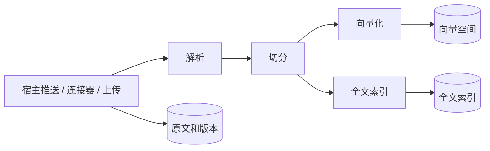
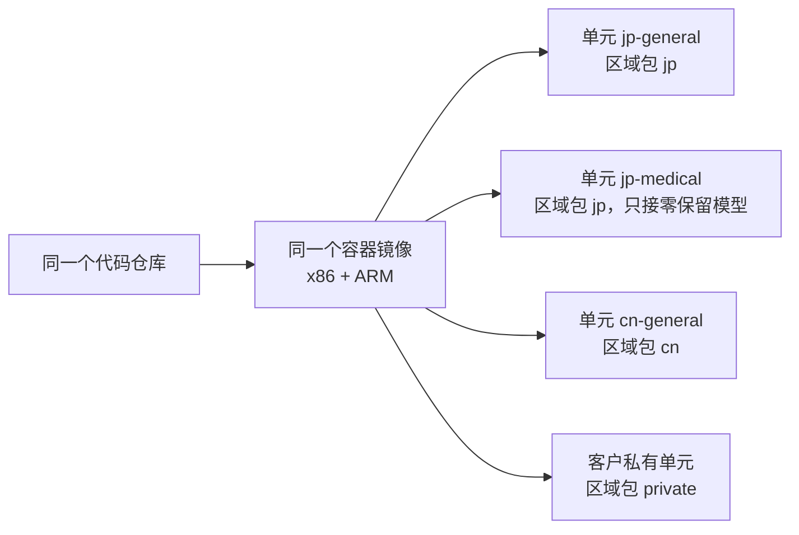

# Intergent AI 引擎架构设计蓝图

> **版本**: v0.4（待冻结）
> **日期**: 2026-11-05
> **状态**: 蓝图草案。Q-1 到 Q-5 已全部确认，所有单向门都已定下，用户确认后升为 v1.0 并冻结
> **权限**: 本文件不授权任何代码改动、远端操作或部署
> **关联**: [AI 产品平台技术方案](ai-product-platform-technical-plan.md)（为什么做、做什么）、[AI 客服方案](ai-customer-service-module-development-guide.md)（第一个产品）

---

## 0. 文档定位与读者指引

本文档是 AI 引擎的**唯一架构蓝图来源**。读者是项目负责人和后续开发者（包括 AI 编码代理）。

蓝图只承载稳定的、契约性的、与具体业务无关的内容。结构和术语尽量与 Brix 运行壳蓝图保持一致：原则定方向，约束定结构，红线定边界。

### 0.1 设计目标

1. **独立**：引擎不依赖任何宿主系统，能接入任何系统。
2. **一套代码，多地运营**：大陆、海外、客户机房使用同一个镜像，差异只在配置。
3. **最小实现，不留死路**：Dev 阶段只保证正确性和可演化，功能做到商用级做法的最小实现，以后只长大，不推倒重来。

### 0.2 冻结什么，不冻结什么

借用 Amazon 的单向门和双向门思路：不可逆的决定要在一开始想清楚，可逆的决定不必花时间。这份蓝图只冻结单向门。

| 单向门：现在定死 | 双向门：可以随时换 |
| --- | --- |
| 对外 API 的约定（版本、错误、幂等、事件格式） | 具体模型、模型厂商 |
| 租户、应用、数据等级的模型 | HTTP 框架、数据访问库 |
| `tenant_id` 贯穿所有数据 | 向量库、全文检索实现 |
| 分层和依赖方向 | 作业队列实现 |
| 单元之间无运行时连接 | 云厂商、部署平台 |
| 区域差异只在区域包 | 监控和评测工具 |
| 主要语言 | 聊天组件的前端技术 |

判断标准：改变它要不要动客户的集成、动存量数据，或者动全部模块。要动就是单向门。

### 0.3 蓝图边界

| 内容 | 去向 |
| --- | --- |
| 业务规则、产品功能 | 各产品方案 |
| 法律合规结论 | 平台方案第 4.5、9 节 |
| 具体模型清单、价格 | 区域包配置 |
| 字段级设计、接口细节 | 后续专项设计文档 |
| 实施排期 | 平台方案第 11 节 |

---

## 文档目录

- [1. 设计原则](#1-设计原则)
- [2. 设计约束](#2-设计约束)
- [3. 架构总览](#3-架构总览)
- [4. 能力契约](#4-能力契约)
- [5. 模块模型](#5-模块模型)
- [6. 对外契约](#6-对外契约)
- [7. 租户与数据模型](#7-租户与数据模型)
- [8. AI 网关](#8-ai-网关)
- [9. 信任层](#9-信任层)
- [10. 编排模型](#10-编排模型)
- [11. 知识、作业与事件](#11-知识作业与事件)
- [12. 部署与单元](#12-部署与单元)
- [13. 可观测与评测](#13-可观测与评测)
- [14. 技术栈冻结表](#14-技术栈冻结表)
- [15. Dev 阶段最小实现与演进路径](#15-dev-阶段最小实现与演进路径)
- [16. 架构红线](#16-架构红线)
- [17. 冻结流程](#17-冻结流程)
- [附录 A：大厂案例对照](#附录-a大厂案例对照)
- [附录 B：参考资料](#附录-b参考资料)

---

## 1. 设计原则

> 设计原则解释为什么这么设计，演进极慢。案例详见附录 A。

| # | 原则 | 核心要义 | 依据 |
| --- | --- | --- | --- |
| **P-1** | API 优先 | 所有能力先是公开契约。自家产品也走同一套契约，不走后门 | Stripe |
| **P-2** | 宿主掌握业务真相 | 业务数据在宿主。引擎只存派生数据（索引、日志、作业），可以删除重建 | LinkedIn Skill Inversion；工程判断 |
| **P-3** | 契约与实现分离 | 模块只依赖能力契约，基础设施藏在适配器后面 | Brix P-1、P-3 |
| **P-4** | 模型是可替换部件 | 业务代码不知道用的是哪个模型。同一套基础设施服务多种模型 | LinkedIn、Uber |
| **P-5** | 工作流优先，自主受控 | 能用固定流程解决的不用自主 Agent。从最简单的方案开始，需要时才加复杂度 | Anthropic |
| **P-6** | 模型提建议，规则做决定 | 涉及钱、权限、法律的决定由确定性代码或人做出 | Salesforce Trust Layer；Sierra、Decagon |
| **P-7** | 假设注入必然发生 | 不靠模型自觉，靠架构限制后果 | Meta Agents Rule of Two |
| **P-8** | 单元独立，静态稳定 | 单元能独立运行。控制面故障不影响已运行的服务 | AWS、Slack |
| **P-9** | 模块化单体 | 一个部署单元，模块边界严格。不从微服务开始 | Shopify |
| **P-10** | 评测是发布门禁 | 提示词、模型、路由的变更，和代码变更一样要过测试 | Shopify Sidekick、Anthropic |
| **P-11** | 契约一次做对，实现逐步长大 | 单向门现在定死，双向门用最小实现 | Amazon 单向门、双向门 |

---

## 2. 设计约束

> 约束是原则的具象化。红线是约束里可以机器校验的子集。

### 2.1 核心术语

| 术语 | 含义 |
| --- | --- |
| 宿主 | 接入引擎的外部系统，如 WooCommerce 站点、Brix、客户自研系统 |
| 租户 | 合同和计费主体 |
| 应用 | 租户下的一个集成，持有密钥、API 版本、动作和回调配置。分测试和正式 |
| 单元 | 一套完整独立的部署，有自己的数据库和密钥 |
| 区域包 | 一个单元的外部依赖配置：模型、存储、内容安全等 |
| 端口 | 引擎内部的能力契约，如 `ModelPort` |
| 适配器 | 端口的实现，如 Claude 适配器 |
| 任务 | 业务对模型的需求，如 `customer_chat`。业务代码只说任务，不说模型 |
| 数据等级 | `public`、`internal`、`personal`、`sensitive` |
| 宿主动作 | 宿主声明的、引擎可以回调的能力，如查订单 |

### 2.2 约束清单

| # | 约束 | 说明 |
| --- | --- | --- |
| **C-1** | 引擎不依赖任何具体宿主 | 不出现 WooCommerce、Brix 等业务概念。宿主差异在连接器里 |
| **C-2** | 依赖方向只能向内 | 见 3.2 |
| **C-3** | 模型调用只经 AI 网关 | 模块不得直接调用模型 SDK |
| **C-4** | 模块只走公开接口或事件 | 不跨模块读写表 |
| **C-5** | 租户隔离贯穿所有数据 | 每张业务表有 `tenant_id`，受行级安全保护 |
| **C-6** | 写入可安全重试 | 有副作用的接口支持幂等键 |
| **C-7** | 数据等级只升不降 | 请求可以提高等级，不能低于应用的默认等级 |
| **C-8** | 区域差异只在区域包 | 代码里没有地区判断 |
| **C-9** | 一个镜像，多种角色 | `api`、`worker`、`migrate` 靠启动参数区分 |
| **C-10** | 计算无状态 | 状态都在数据库、缓存、文件存储里，实例可以随时替换 |
| **C-11** | 外部调用必有超时 | 模型、宿主、存储，一律有超时 |
| **C-12** | 单元之间无运行时连接 | 只有代码发布单向流动 |

---

## 3. 架构总览

### 3.1 系统上下文



### 3.2 分层模型



| 层 | 职责 | 允许依赖 |
| --- | --- | --- |
| 产品层 | 业务流程、业务状态、业务界面 | 接入层 |
| 接入层 | 让宿主方便地调用引擎 | 公开 API |
| 接口层 | 协议、鉴权、限流、版本转换。不含业务逻辑 | 能力模块 |
| 能力模块 | 对话、知识、文档、动作等能力 | 平台核心、端口 |
| 平台核心 | 所有能力共用的横切机制 | 端口 |
| 能力契约 | 纯接口，不含实现 | 无 |
| 适配器 | 实现端口，封装厂商 SDK 和驱动 | 能力契约、外部 SDK |

组装由极薄的启动入口完成：读取配置，把适配器接到端口上。这对应 Brix 的 Ultra-Thin Host。

### 3.3 单元内部结构



Dev 阶段的依赖只有一个镜像、一个数据库、一个 Redis 和一个文件存储，本地开发可以再减掉 Redis。

### 3.4 仓库结构

新建独立的私有仓库 `brix-kit-dev/intergent`。后端用 Maven 多模块，前端和 JS SDK 用 pnpm，和 Brix 的组合相同：

```text
contracts/         OpenAPI 3.1 契约，公开 API 的唯一源头
engine/            Maven 多模块
  ports/           能力契约（L1），纯接口
  core/            平台核心（L2）：gateway、trust、jobs、events、tenancy、metering
  modules/         能力模块（L3）：conversation、knowledge、document、action
  adapters/        适配器（L0）：model-anthropic、model-google、model-openai-compat、
                   store-postgres、store-kingbase、blob-s3 等
  app/             极薄启动入口，api、worker、migrate 三个角色
sdk/
  java/            Java SDK（L5），Brix 也用它
  typescript/      TypeScript SDK（L5），由契约生成
web/               pnpm 工作区
  widget/          聊天组件
  console/         小控制台
products/
  customer-service/  AI 客服（产品层，只依赖 sdk 和 contracts）
connectors/
  woocommerce/     WordPress 连接器
regions/
  jp/ cn/ private/ 区域包配置
prompts/           提示词，按任务和模型系列分版本
evals/             评测集，按任务和语言分
deploy/            镜像、Compose、Helm、ECS 配置
```

Java 包名和 Maven 命名空间跟随注册到的域名，第一次发布 SDK 之前定下即可。

---

## 4. 能力契约

### 4.1 端口清单

| 端口 | 职责 | Dev 适配器 | 以后可换成 |
| --- | --- | --- | --- |
| `ModelPort` | 文本和视觉生成，含流式和工具调用 | Anthropic、Google、OpenAI 兼容、模拟模型 | 任何新厂商 |
| `EmbeddingPort` | 文本转向量 | voyage、OpenAI 兼容 | 本地 BGE-M3 |
| `RerankPort` | 重排序 | 空实现或 voyage | 本地模型 |
| `SpeechPort` | 语音转写 | 暂不实现 | Scribe、Chirp、国产服务 |
| `OcrPort` | 文档识别和版面解析 | 视觉模型 | Python 附加容器 |
| `VectorStorePort` | 向量写入和检索 | pgvector | 金仓向量、Milvus、Qdrant |
| `SearchPort` | 全文检索 | 数据库全文索引 | OpenSearch |
| `BlobPort` | 文件读写、签名地址 | S3 接口 | 任何 S3 兼容存储 |
| `JobPort` | 入队、重试、延迟、并发控制 | db-scheduler | Redis 队列、Temporal |
| `CachePort` | 缓存和限流计数 | Redis 协议，本地用内存 | 无 |
| `ModerationPort` | 输入输出内容审核 | 基础规则 | 大陆内容安全服务 |
| `RedactionPort` | 个人信息遮盖和还原 | 规则匹配 | 专用服务 |
| `ActionTransportPort` | 回调宿主 | HTTP | MCP |
| `NotifyPort` | 验证码、人工回复 | 邮件 | 短信、LINE、企业微信 |
| `SecretPort` | 取得密钥 | 环境变量 | KMS、Vault |
| `TelemetryPort` | 追踪、指标、模型调用记录 | OpenTelemetry | 无 |

### 4.2 端口规则

- 端口不暴露厂商概念。不出现 `anthropic_version` 这样的字段。
- 端口只增可选成员。破坏性修改走第 17 节的变更流程。
- 适配器声明自己的能力（能否看图、调工具、结构化输出），调用方按能力判断，不按厂商判断。
- 每个端口都有一个内存或模拟实现，用于测试和离线开发。Microsoft 的网关指南也建议用模拟端点控制开发成本。

---

## 5. 模块模型

### 5.1 模块清单

| 模块 | 层 | 职责 | 拥有的数据 | Dev 阶段 |
| --- | --- | --- | --- | --- |
| `tenancy` | L2 | 租户、应用、密钥、会话令牌 | 租户、应用、密钥 | 做 |
| `gateway` | L2 | 模型路由、重试、计量 | 用量记录 | 做 |
| `trust` | L2 | 入站出站检查、策略、审计 | 审计记录 | 做 |
| `jobs` | L2 | 作业调度 | 作业 | 做 |
| `events` | L2 | Outbox 和 Webhook | Outbox、回调配置 | 做 |
| `conversation` | L3 | 会话、流式回答、流程执行 | 会话、消息 | 做 |
| `knowledge` | L3 | 入库、检索、引用 | 文档、片段、向量 | 做 |
| `action` | L3 | 宿主动作的注册和调用 | 动作声明 | 只读动作 |
| `document` | L3 | 解析、翻译流水线 | 文档作业结果 | 后续 |
| `speech` | L3 | 转写 | 转写结果 | 后续 |

### 5.2 模块规则

沿用 Shopify 模块化单体的做法：

- 模块对外只有一个公开接口包，其他都是内部实现。
- 模块拥有自己的表，表名带模块前缀。跨模块不读表、不建外键。
- 模块之间同步调用走公开接口，异步走事件。
- 边界由工具在 CI 里强制，不靠自觉。

这样任何一个模块以后都能拆成独立服务，只要把进程内调用换成 HTTP。`gateway` 最可能先拆，Uber 和 GitLab 都把它做成了独立服务。

### 5.3 两种调用方式

产品层通过 `EngineClient` 接口使用引擎，有两个实现：

| 实现 | 用途 | 对应 Brix |
| --- | --- | --- |
| 进程内客户端 | 起步时 AI 客服和引擎同进程 | 嵌入式 Host |
| HTTP 客户端 | 独立部署，也是外部 SDK | 独立 Host |

接口相同，所以产品层从不感知部署方式，也不可能走后门。

### 5.4 引擎和产品的边界

| 进引擎 | 留在产品或宿主 |
| --- | --- |
| 跨产品复用的能力 | 只有一个产品用的业务规则 |
| 几分钟到几小时的作业 | 跨天的业务流程，如退货、医疗案件 |
| 模型、检索、翻译、抽取、转写 | 退货规则包、例外队列、医疗审校界面 |

判断方法：把这段逻辑放进引擎后，引擎是否开始知道某个具体行业。知道了就不该放。

---

## 6. 对外契约

### 6.1 接入方式

| 方式 | 客户要做什么 | Dev 阶段 |
| --- | --- | --- |
| 聊天组件 | 把一段脚本放进网页 | 做 |
| 平台插件 | 安装 WordPress 连接器 | 做 |
| REST、SDK、Webhook | 调接口 | 做 |
| MCP | 接入 AI 工具生态 | 留口子，不做 |
| 私有部署 | 在客户环境运行镜像 | 架构支持，不做交付物 |

### 6.2 REST 约定

这些约定一旦发布，改动代价极高，是最重要的单向门。

| 项目 | 约定 | 依据 |
| --- | --- | --- |
| 版本 | 路径 `/v1`，加日期版本头 `Engine-Version: 2026-11-05`。每个应用锁定一个日期版本 | Stripe。Dev 阶段只有一个版本，版本转换层在第一次破坏性变更时才写 |
| 兼容规则 | 新增字段、新增可选参数不算破坏性。删除、改名、改语义才算 | Stripe |
| 错误 | `application/problem+json`，带稳定的 `code` | RFC 9457 |
| 幂等 | 所有有副作用的 POST 接受 `Idempotency-Key` | Stripe；IETF 草案 08 |
| 追踪 | 接收并透传 `traceparent`，响应返回 `Request-Id` | W3C Trace Context |
| 分页 | 游标分页，不用页码 | Stripe |
| ID | 带类型前缀的可排序字符串，如 `conv_...`。密钥带环境和单元信息，如 `aie_live_jp1_...`。前缀不用品牌名，产品改名不影响存量密钥 | Stripe。为将来按单元路由留口子 |
| 时间 | RFC 3339，UTC | — |
| 语言 | 请求带 `locale`，错误信息可本地化，`code` 不变 | — |

### 6.3 资源一览

| 资源 | 用途 | Dev 阶段 |
| --- | --- | --- |
| `POST /v1/sessions` | 宿主后端为终端用户换取短期令牌 | 做 |
| `POST /v1/conversations`、`/{id}/messages` | 对话，`Accept: text/event-stream` 时流式 | 做 |
| `PUT/DELETE /v1/knowledge/documents/{externalId}` | 宿主推送或删除内容 | 做 |
| `POST /v1/retrieve` | 检索，返回片段和引用 | 做 |
| `PUT /v1/actions/{name}` | 声明宿主动作 | 做 |
| `POST /v1/webhook-endpoints` | 配置回调 | 做 |
| `GET /v1/jobs/{id}` | 查询作业 | 做 |
| `POST /v1/translations`、`/extractions`、`/transcriptions` | 异步能力，返回作业 | 后续 |
| `GET /v1/usage` | 用量查询 | 做 |

**不提供裸模型接口。** Anthropic 商业条款禁止转售服务本身。以后提供 OpenAI 兼容入口时，也只暴露引擎的助手能力，不做模型直通。

### 6.4 流式事件

用引擎自己的事件类型，不绑定任何厂商或协议。AG-UI 等协议还在收敛，以后在接入层做转换。

| 事件 | 含义 |
| --- | --- |
| `message.delta` | 文本增量 |
| `message.citation` | 引用来源 |
| `tool.started`、`tool.finished` | 宿主动作执行中 |
| `handoff.requested` | 需要转人工 |
| `message.completed` | 完成，带用量 |
| `error` | 错误，格式同 RFC 9457 |

### 6.5 身份模型

分两层，浏览器里永远没有长期密钥。这和 Stripe 的客户端令牌是同一种思路。



| 身份 | 形式 | Dev 阶段 |
| --- | --- | --- |
| 宿主服务 | API 密钥，只存哈希，按应用发放，可轮换 | 做 |
| 终端用户 | 短期令牌，写明租户、应用、用户、身份等级、权限范围 | 做 |
| 匿名访客 | 公开站点键加来源校验，换取最低权限令牌 | 做 |
| 平台型宿主 | 一个密钥代多个下级租户操作，请求头 `On-Behalf-Of` | 字段和校验现在留好 |
| 企业单点登录 | OIDC | 后续 |

平台型宿主是给 Brix 这类本身多租户的系统留的。它对应 Stripe Connect 的模式，事后补会动租户模型，所以现在就把 `parent_tenant_id` 留好。

### 6.6 宿主动作

这是能接入任何系统的核心机制。LinkedIn 的 Skill Inversion 是同一思路：由下游服务定义和暴露自己的能力，不由调用方包一层又一层。



| 规则 | 说明 |
| --- | --- |
| 风险等级 | `read`、`write`、`money`。`money` 默认禁用，要规则或人工确认 |
| 身份注入 | 订单号、用户、租户由服务端注入，不作为模型参数 |
| 宿主终审 | 宿主收到请求后自己再校验权限，引擎的校验不能替代它 |
| 防 SSRF | 地址只能是声明时校验过的白名单域名，禁止内网地址 |
| 结果限制 | 限时、限大小，结果视为不可信 |

### 6.7 Webhook

遵循 [Standard Webhooks](https://www.standardwebhooks.com/)：HMAC 签名、时间戳防重放、支持轮换密钥。它的兼容实现列表包含 OpenAI、Anthropic、Google Gemini、Twilio。

投递语义是至少一次。事件带唯一号，宿主按它去重。失败按退避重试，耗尽后可手动重放。

### 6.8 与 Brix 的对接

| 项目 | 做法 |
| --- | --- |
| 接入方式 | `runtime-sdk-api` 增加 `AiCapability`，适配器用引擎的 Java SDK，走公开 API |
| 区域 | 沿用 `DEPLOY_REGION` |
| 租户 | Brix 作为平台型宿主，用 `On-Behalf-Of` 映射下级租户 |
| 事件 | 引擎 Webhook 进入 Brix 的 `infra-adapter-webhook`，再走 Brix 事件总线 |
| 界面 | 控制台以后通过 Module Federation 并入 Brix |

### 6.9 与 Brix 的异同

骨架相似是有意的：两边都用端口和适配器这套成熟模式，本蓝图也对齐了 Brix 的写法。对应关系：`Capability` 对应端口，`infra-adapter-*` 对应适配器，极薄 Host 对应 `engine/app`，架构守卫对应 ArchUnit 检查。Outbox、Webhook 和红线写法也一致。`DEPLOY_REGION` 沿用 Brix 蓝图里的变量名，Brix 公开仓库的代码里还没有实现。

定位不同：

| 对比项 | Brix | AI 引擎 |
| --- | --- | --- |
| 是什么 | 构建业务系统的框架 | 被其他系统调用的服务 |
| 怎么扩展 | 开发者写插件和微前端，装进 Host | 调用方走 API、Webhook、MCP，不往引擎里装代码 |
| 业务数据 | 系统自己持有 | 只存派生数据（P-2） |
| 核心难题 | 模块装配、权限、事件治理 | 模型路由、数据等级、信任层、检索、评测 |
| 租户隔离 | 应用层：`tenant_id` 过滤和拦截器 | 数据库行级安全强制（T-1、T-2） |
| 界面 | Module Federation 微前端 | 聊天组件和小控制台 |
| 交付 | 按客户配置装配 Host | 同一镜像加区域包 |

**引擎不建在 Brix 上，但技术基线对齐。** 这是单向门。下面的事实于 2026-11-05 对照 GitHub 上 Brix 的 `main`（`0690896`）核实，私有的 `brix-enterprise` 没有读到最新版。

Brix 已经有很多引擎也需要的能力：Spring Boot 4.1.1、类型化端点、带幂等的命令和端点、定时任务、Outbox、Webhook、审计、带时限的外部 HTTP 调用、架构守卫。所以这不是“做不到”，而是目前不值得绑在一起：

| 理由 | 事实 |
| --- | --- |
| 流式 | 代码里查不到 SSE 或流式响应。流式回答是引擎的主路径，要先改 Brix 的端点层 |
| 租户模型 | 隔离靠应用层，代码里没有行级安全。Brix 的模型面向组织和成员，引擎要的是应用、终端用户、`On-Behalf-Of`、数据等级 |
| 变更节奏 | Brix 的架构受冻结蓝图和基线锁管理，架构变更要新版本和评审记录。AI 层变化很快，绑在一起两边都受影响 |

建在 Brix 上不违反 C-1，那条约束说的是业务概念，不是框架。如果以后这三项差距消失，可以重新评估。

基线对齐指 Spring Boot、Flyway、OpenTelemetry、ArchUnit 用相同的大版本，信创适配的结果两边共用。确实通用的代码，如幂等和 Outbox，等引擎 v1 稳定后再考虑抽成共享库。

Brix 的金仓支持目前只有 `DatabaseDialect` 枚举和驱动类名映射，依赖里只有 PostgreSQL 驱动，也没找到实测记录。所以金仓在 Brix 和引擎上都要实测。

---

## 7. 租户与数据模型

### 7.1 实体层次

| 实体 | 关键字段 | 说明 |
| --- | --- | --- |
| Tenant | `id`、`parent_tenant_id`、`isolation_tier`、`cell_id` | 合同和计费主体 |
| Application | `tenant_id`、`environment`、`api_version`、`default_data_class` | 一个集成。测试和正式是两个应用，测试应用默认走模拟模型 |
| EndUser | `application_id`、`external_id` | 只存宿主给的外部标识，引擎不管账号 |
| Principal | 字符串，如 `user:123`、`group:abc`、`public` | 文档权限用 |

### 7.2 隔离等级

沿用 AWS SaaS 的三种模型。从第一天起所有数据都带 `tenant_id`，所以升级隔离等级时只是搬数据，不改代码。

| 等级 | 形式 | 适合 | Dev 阶段 |
| --- | --- | --- | --- |
| Pool | 共享数据库，行级安全隔离 | 中小商户 | 做 |
| Silo | 独立数据库 | 大客户 | 留口子：连接按 `tenant_id` 解析 |
| Cell | 独立单元 | 医疗、合规要求高的客户 | 留口子：部署层面支持 |

行级安全的三个要点：表要 `FORCE ROW LEVEL SECURITY`，应用角色不是表所有者，租户号在事务内用 `SET LOCAL` 传入。

### 7.3 数据等级

| 等级 | 例子 | 模型要求 | 日志要求 |
| --- | --- | --- | --- |
| `public` | 公开商品资料 | 任何批准模型 | 可记录内容 |
| `internal` | 企业内部文档 | 不训练 | 可记录内容，限租户内访问 |
| `personal` | 订单、姓名 | 不训练，有数据处理协议 | 脱敏后记录 |
| `sensitive` | 病历 | 合同零保留，且在批准名单内 | 只记录元数据和哈希 |

没有符合条件的模型时，请求直接失败，不降级。

### 7.4 公平性

多租户共享资源时，一个租户不能拖垮其他租户。Amazon 的目标是让每个客户都感觉自己在用单租户系统。

- 按租户和按应用限流。
- 按租户限制模型并发和作业并发。
- 作业队列按租户公平调度。
- 每个租户有预算硬上限，超限转留言模式。

### 7.5 保留与删除

- 每类数据有保留期，按租户配置，有上限。
- 删除覆盖数据库、向量、文件、监控数据。
- 按租户、按终端用户支持导出和删除，这是第一版就要有的能力。

---

## 8. AI 网关

### 8.1 定位

所有模型调用的唯一入口。Uber 的 GenAI Gateway 和 LinkedIn 的统一推理层证明了这个模式的价值：一个地方解决鉴权、脱敏、计量、审计和换模型。Uber 公开的规模是约 30 个团队、每月 1,600 万次请求，高峰 25 QPS，说明这个模式不是只有大流量才需要。

Dev 阶段它是进程内模块。Microsoft 的指南提醒网关会引入延迟、单点和合规范围，所以先不做成独立服务，接口按能独立部署来设计。

### 8.2 处理流程



### 8.3 模型注册表

合同属性写进配置，路由才能强制执行。这样“医疗数据只走零保留模型”就是代码保证，不是约定（示意）：

```yaml
models:
  - id: bedrock-jp/claude-opus-5-5
    adapter: anthropic
    processing_region: jp
    retention: none          # 合同约定的保留策略
    training: no
    max_data_class: sensitive
    capabilities: [text, vision, tools, structured_output, prompt_cache]
    price: { input: 4, output: 20 }
  - id: fake
    adapter: fake
    max_data_class: public
```

### 8.4 路由表

业务代码只说任务。路由表在区域包里，换模型不改代码（示意）：

```yaml
routes:
  customer_chat:
    primary: claude-sonnet-5-5
    fallback: [gemini-3-5-flash-lite]
    prompt: customer_chat/claude/v3
  document_translate:
    allowed: [bedrock-jp/claude-opus-5-5, vertex-tokyo/gemini-3-5-flash]
```

### 8.5 适配器

三个适配器覆盖绝大多数模型：Anthropic（含 Bedrock）、Google、OpenAI 兼容接口。OpenAI 兼容适配器覆盖 GPT、DeepSeek、通义、智谱和本地 vLLM，各家的实际兼容程度要实测。Uber 和 LinkedIn 都把内部接口统一成 OpenAI Chat Completions 风格，这是同一个思路。

厂商 SDK 和 Spring AI 都只出现在适配器里，它们出问题或不够用时，只需要换适配器。

### 8.6 可靠性

沿用 Amazon 的做法：

| 项目 | 做法 |
| --- | --- |
| 超时 | 每次外部调用都有超时 |
| 重试 | 只在网关这一层重试，次数有上限，指数退避加抖动 |
| 流式 | 只在第一个字节发出前切换模型 |
| 熔断 | 按模型统计失败率，超过阈值暂时跳过 |
| 拒答 | 模型的拒答作为一种结果返回，业务决定转人工 |

### 8.7 提示词管理

沿用 LinkedIn Prompt Source of Truth 的做法：提示词放在 `prompts/` 里，按任务和模型系列分版本，不可变，随路由表一起发布，能按比例灰度。

### 8.8 向量模型例外

换向量模型要重建索引，不能靠改路由表解决。所以：保留原文；每个向量空间独立存放，记录模型版本；迁移时新旧并行，切换后再删旧的。

---

## 9. 信任层

### 9.1 处理链路

Salesforce Trust Layer 把这些能力做成一个固定层：基于自有数据回答、遮盖敏感数据、检测有害内容、审计、与模型厂商的零保留协议。引擎采用同样的结构。



### 9.2 流式和检查的取舍

流式输出时拿不到全文，所以按任务配置检查方式：

| 模式 | 适合 | 做法 |
| --- | --- | --- |
| 按句缓冲 | 普通问答 | 攒够一句检查一次再发 |
| 全文缓冲 | 高风险内容，如退货结论、医疗 | 生成完检查后再发 |

### 9.3 注入防护

采用 Meta 的 Agents Rule of Two：同一会话里，“处理不可信输入”“访问敏感数据”“改变状态或对外通信”三项最多占两项。

| 会话类型 | 不可信输入 | 敏感数据 | 改变状态 |
| --- | --- | --- | --- |
| 匿名访客 | 有 | 无 | 无 |
| 已验证顾客查单 | 有 | 有（只限本人） | 无 |
| 提交申请 | 有 | 有 | 由人或规则确认后才生效 |
| 视觉取证 | 有 | 无 | 无，且没有任何工具 |

配套规则：工具按身份由服务端过滤；检索内容和动作结果都按不可信数据处理；模型输出不能直接触发不可逆动作。

### 9.4 审计

审计只追加，不修改。记录谁、哪个应用、什么任务、用了哪个模型和提示词版本、依据什么规则、结果是什么。`sensitive` 等级只记录元数据和内容哈希。

---

## 10. 编排模型

Anthropic 区分工作流和 Agent：工作流走预定义的代码路径，Agent 由模型自己决定过程。它建议从最简单的方案开始。引擎提供三种执行形态，按顺序优先选用：

| 形态 | 适合 | 例子 |
| --- | --- | --- |
| 单次调用 | 分类、抽取、翻译、问答 | 回答商品问题 |
| 流程 | 步骤确定，模型负责听懂和表达 | 查单 |
| 受控循环 | 步骤不确定，范围有限 | 综合问题的多步查询 |

受控循环的硬限制：

- 步数、token、时长都有上限。
- 单次上下文的工具不超过 20 个。Shopify 的经验是 0–20 个容易调试，20–50 开始出现意外组合，50 以上难以推理。
- 说明按需提供，不堆在系统提示词里。Shopify 把这个做法叫即时指令，好处是模块化，也不破坏提示词缓存。

**不引入 Agent 框架。** 模型调用和循环只有几百行，Anthropic 也建议先直接用 API，框架容易遮蔽底层的提示词和响应。LinkedIn 选了 LangChain，但它有专门的平台团队。

---

## 11. 知识、作业与事件

### 11.1 知识入库



每份文档从第一天起就带这些字段，事后补等于重建：`external_id`、`version`、`locale`、`data_class`、`acl`、`content_hash`。`acl` 起步可以只有 `public`，但检索时必须已经按它过滤。

### 11.2 检索

向量检索加全文检索，合并后重排序，再按权限过滤。过滤发生在检索阶段，不在检索之后。

全文检索的 Dev 实现是**应用层分词**：用运行时自带的分词能力处理日语和中文，把结果写进数据库的标准全文索引。这样不依赖 PGroonga 这类扩展，在 PostgreSQL 和金仓上用同一套逻辑。质量要在样机阶段验证。

Instacart 把商品搜索的词法和向量检索合并到 Postgres 加 pgvector，理由是少维护一套系统、不用同步两边的数据。这是 Dev 阶段选 pgvector 的依据。规模到了再换专用向量库，`VectorStorePort` 和保留的原文保证迁移可行。

### 11.3 作业

耗时任务一律异步。作业的语义是冻结的，实现可以换：

| 语义 | 说明 |
| --- | --- |
| 幂等 | 每一步可以安全重跑 |
| 状态 | `queued`、`running`、`succeeded`、`failed`、`canceled` |
| 重试 | 退避重试，耗尽进死信 |
| 公平 | 按租户限并发 |
| 结果 | 大结果放文件存储，给签名地址 |

跨天的业务流程不是作业，留在产品或宿主里。业务状态放产品自己的表，作业引擎只负责执行，所以以后换 Temporal 不动业务。Temporal 是这个领域最成熟的方案，OpenAI 等公司在用，但它要多运维一套服务，Dev 阶段不需要。

### 11.4 事件

业务写入和事件写入在同一个事务里（Outbox），由 `worker` 投递，保证不丢不漏。这和 Brix 的 A-10 红线是同一规则。内部消费者变多时再接消息队列，Outbox 表不变。

---

## 12. 部署与单元

### 12.1 单元



单元之间没有运行时连接。跨区传递业务资料走宿主的业务接口，要有同意记录和审计。

### 12.2 区域包

`DEPLOY_REGION` 决定加载哪个区域包，和 Brix 蓝图同一个变量名（示意）：

```yaml
region: cn
adapters:
  database: kingbase
  vector: kingbase
  blob: s3
  moderation: cn-content-safety
  notify: sms
models: ./models.yaml
routes: ./routes.yaml
policies:
  ai_disclosure: required
  ai_content_label: required
egress_allowlist:
  - "*.aliyuncs.com"
```

| 规则 | 说明 |
| --- | --- |
| 部署时确定 | 租户配置不能覆盖区域包 |
| 出站白名单 | 网络层兜底，配错了也连不出去 |
| 能力开关 | 大陆的内容审核、标识是开关，不是分支代码 |

### 12.3 部署形态

GitLab Duo 的三种形态和这里的需求几乎一样：完全自托管（网关和模型都在客户环境，数据不出网络）、混合、由厂商托管。

| 形态 | 说明 | 对应 GitLab | Dev 阶段 |
| --- | --- | --- | --- |
| 共享单元 | 多租户 SaaS | GitLab.com AI Gateway | 做 |
| 专属单元 | 一个客户一套，由您运维 | Dedicated | 部署层面支持 |
| 私有单元 | 客户机房，本地模型，可离线 | 完全自托管 | 架构支持 |

私有部署时只允许回传计费元数据，离线版不回传。GitLab 的做法是推理数据不出客户网络，只有在线许可才回传调用次数等计费元数据。

### 12.4 控制面

AWS 的指南把控制面（管理单元）和数据面（提供服务）分开，并要求控制面故障时数据面继续运行。

| 阶段 | 做法 |
| --- | --- |
| Dev 阶段 | 没有控制面服务。配置进仓库，部署时加载，运行时不依赖外部配置中心 |
| 单元超过三个 | 增加控制面服务，负责开通租户和发布配置 |

### 12.5 运行角色

| 角色 | 职责 | 扩展方式 |
| --- | --- | --- |
| `api` | 处理请求和流式回答 | 水平扩展 |
| `worker` | 作业、Outbox、定时任务 | 按队列长度扩展 |
| `migrate` | 数据库迁移，部署时运行一次 | 不适用 |

### 12.6 开发环境

开发在远程服务器上进行。开发服务器不是单元，不进入上面的部署模型。服务器的地区和规格是双向门，开始开发前定下即可，下面的规则到时候适用。

| 规则 | 说明 |
| --- | --- |
| 服务器位置 | 放在 Claude 支持的地区，如日本。不放在中国大陆、香港、澳门，否则调不通海外模型，也不符合 Anthropic 的支持地区政策 |
| 数据 | 只放测试数据，不放真实客户或医疗数据 |
| 模型密钥 | 开发专用，设消费上限，写入服务器环境，不进仓库 |
| GitHub 权限 | 用只能访问本仓库的部署密钥或细粒度令牌。不放能访问 `brix-enterprise` 的个人令牌，因为 npm 蠕虫专偷开发机上的令牌 |
| 依赖安装 | 和 CI 同样遵守 S-8 |
| 网络 | 只开 SSH，内部服务走 SSH 隧道 |
| 规格 | 4 核 16 GB 起步（工程估算）。Langfuse 自托管要 ClickHouse，Dev 阶段先用云服务或不开 |

### 12.7 大陆信创

财政部和工信部的《数据库政府采购需求标准（2023 年版）》规定：乡镇以上党政机关，以及乡镇以上党委和政府直属事业单位、部门所属为机关提供支持保障的事业单位，采购数据库时要把“符合安全可靠测评要求”纳入采购需求，其他单位可以不提。操作系统和 CPU 有同类条款。

测评名单列的是厂商产品。已查到的 2025 年汇总和 2026 年第 2 号公告里没有社区版 PostgreSQL。所以信创单元不能用它，大陆其他客户可以用，除非招标文件另有要求。

| 层 | 信创单元的做法 | 状态 |
| --- | --- | --- |
| 数据库 | 名单内产品，跟随 Brix 首选金仓，走 JDBC | V-1 |
| CPU | 鲲鹏、飞腾用 ARM 镜像，海光用 x86 镜像，龙芯按项目构建 | V-6 |
| 操作系统 | 麒麟、统信 | V-6 |
| JDK | Java 21，OpenJDK 21 有 LoongArch 移植版 | V-6 |
| 应用中间件 | 招标要求国产中间件时才需要。只查到东方通支持 Spring Boot 2.x 的资料，Boot 3、4 未确认，这同样影响 Brix | V-7 |
| 模型 | 国产模型，经 OpenAI 兼容适配器 | V-4 |

这些差异都在区域包和部署层，不进代码（C-8）。

---

## 13. 可观测与评测

### 13.1 可观测

| 信号 | 做法 |
| --- | --- |
| 追踪 | OpenTelemetry，全链路 `traceparent`，宿主和引擎的日志对得上 |
| 模型调用 | Langfuse，记录提示词版本、模型、用量、延迟。内容按数据等级脱敏 |
| 指标 | 按租户、任务、模型统计错误率、延迟、费用 |
| 日志 | 结构化，写入前脱敏 |

Dev 阶段先定义指标，不承诺服务等级。

### 13.2 评测

| 环节 | 做法 | 依据 |
| --- | --- | --- |
| 考题来源 | 从真实对话抽样，不只靠编写 | Shopify Sidekick |
| 确定性断言 | 工具调用、规则结果、引用用代码判断 | Anthropic |
| 模型评分 | 措辞用模型打分，先和人工标注校准 | Shopify 把评分一致性从 0.02 提到 0.61，人工之间是 0.69 |
| 门禁 | 提示词、模型、路由变更都要过评测，回归项不过就阻止发布 | P-10 |
| 灰度 | 新版本先回放历史对话，再小比例试运行 | LinkedIn 对提示词也按比例灰度 |

---

## 14. 技术栈冻结表

冻结级别：**F** 现在冻结；**I** 接口冻结，实现可换；**V** 待样机验证。

| 层 | 选型 | 级别 | 理由 | 备选 |
| --- | --- | --- | --- | --- |
| 主要语言 | Java 21 起，Spring Boot 4.1 | F | 见 14.1 | — |
| 前端和 JS SDK | TypeScript 严格模式 | F | 运行在浏览器和宿主前端 | — |
| 本地 AI 处理 | Python，只作附加容器 | F | 本地 OCR、语音的生态在 Python | — |
| 对外契约 | OpenAPI 3.1 文件为源头，生成 Java 接口和 TypeScript 类型 | F | 两种语言共用一份契约，类型、校验、文档、SDK 同源 | — |
| 错误格式 | RFC 9457 | F | IETF 标准 | — |
| 回调 | Standard Webhooks | F | 开放规范，主流厂商兼容 | — |
| 追踪 | W3C Trace Context、OpenTelemetry | F | 行业标准 | — |
| 交付物 | OCI 容器镜像，x86 和 ARM；龙芯按项目构建 | F | 一套代码的前提 | — |
| 数据库 | PostgreSQL 家族（PostgreSQL、金仓） | F，金仓 V | OpenAI 用 Postgres 支撑 ChatGPT 的 8 亿用户（第三方总结：单主库加大量只读副本） | 名单内其他 PostgreSQL 系产品 |
| 文件 | S3 接口 | F | 各地都有实现 | — |
| 模型接入 | Spring AI 2.x，只在适配器里用 | I | 覆盖 Anthropic、Bedrock、Google、OpenAI、DeepSeek，都支持流式和工具调用 | 官方 Java SDK |
| Agent 框架 | 不用 | F | 见第 10 节。Spring AI 只用模型调用层 | — |
| HTTP 框架 | Spring MVC，虚拟线程，SSE 流式 | I | 写法简单，不用响应式编程。工程判断 | WebFlux |
| 数据访问 | Spring `JdbcClient`，手写 SQL，Flyway 迁移 | I | 贴近 SQL，便于控制方言和 `SET LOCAL`。Flyway 和 Brix 一致。工程判断 | jOOQ |
| 向量 | pgvector 语法 | I、V | Instacart 案例。金仓要实测 | Milvus、Qdrant |
| 全文检索 | 应用层分词加标准全文索引 | I、V | 不依赖数据库扩展 | OpenSearch |
| 作业 | db-scheduler | I、V | 只依赖数据库。金仓要实测。工程判断 | Redis 队列、Temporal |
| 缓存和限流 | Redis 协议 | I | 各地都有实现 | — |
| 模型调用记录 | Langfuse | I | 有自托管版，云服务有日本区 | Phoenix |
| 组件 | Web Component（Lit） | I | 不依赖宿主前端框架 | — |
| 控制台 | React + Vite | I | 以后能接入 Brix 微前端 | — |
| 工程 | 后端 Maven、JUnit、Testcontainers；前端 pnpm、Vitest | I | 和 Brix 一致 | — |
| 边界检查 | ArchUnit、OpenAPI 差异检查 | I | 红线要机器校验，Brix 也用 ArchUnit | — |
| 依赖许可 | 引擎镜像不含 GPL、AGPL 类依赖 | F | 引擎闭源，要交付到客户机房 | — |
| 部署 | Compose（本地、小型私有）、ECS（AWS）、Kubernetes（大陆云） | I | 同一镜像 | — |

大厂案例只支撑模式，不支撑每个具体库。HTTP 框架、数据访问库这几项是工程判断，正因为如此才定为可换。

### 14.1 为什么主要语言是 Java

这是本表争议最大的一项。v0.2 建议 TypeScript，v0.3 改为 Java，2026-11-05 确认。大厂没有统一答案：LinkedIn 的在线服务主要是 Java，仍选 Python 做 GenAI；Uber 的网关是 Go。语言不是架构成败的关键，契约才是。

改变结论的是大陆信创（12.7）。下列事实于 2026-11-05 核实：

| 事实 | 影响 |
| --- | --- |
| 信创单元不能用社区版 PostgreSQL | 必须支持国产库 |
| 金仓的 JDBC 驱动在 Maven 中央仓库。官方 Node.js 驱动 `kb` 不在 npm，以文件夹交付，手册没写连接池和事务，V8 手册写明基于 Node.js 10.19.0。npm 上同名的 `kb` 是无关的个人包 | Java 是厂商支持的路径，Node.js 只能靠社区做法和实测 |
| 其他国产库的 Node.js 支持参差不齐：达梦有官方 `dmdb`，GaussDB 有早期版本的 `gaussdb-node`，瀚高没查到官方驱动 | 换库时 Java 只换 JDBC 驱动，Node.js 可能要换驱动和数据访问层 |
| Node.js 把龙芯（loong64）列为实验级，并写明生产只用 Tier 1、Tier 2 平台 | OpenJDK 21 有 LoongArch 移植版 |
| Brix 已在 Spring Boot 4.1.1。Anthropic、OpenAI、Google、MCP 都有持续发布的 Java SDK，Spring AI 2.x 已发布 | Java 在模型接入上没有硬缺口 |

结论：Java 覆盖全部部署场景，TypeScript 只稳妥覆盖非信创场景。主要语言是单向门，所以选覆盖全部场景的一边。

代价：

| 代价 | 说明 |
| --- | --- |
| 两套工具链 | 组件、控制台、JS SDK 仍是 TypeScript。Brix 已经是这个组合 |
| 类型不能直接共用 | 由 OpenAPI 文件生成两边的类型 |
| 动态 JSON 更繁琐 | 宿主动作的 schema 运行时才知道，用 JSON Schema 校验库处理 |
| AI 工具生态 | n8n、Langfuse、FastGPT、Medplum、Mastra、Portkey 网关的后端都是 TypeScript，新工具常常先有 TypeScript 和 Python 版。适配器可以用官方 Java SDK 兜底 |

功能上两种语言都能实现本蓝图。TypeScript 的好处是这个仓库只有一种语言，Java 的好处是公司所有后端只有一种语言（Brix 和引擎）。两边都还有 WordPress 连接器的 PHP 和可选的 Python 容器。

附带的好处：npm 蠕虫风险基本留在前端构建，不进服务端运行时；文档解析和分词可以用 Tika、PDFBox、Lucene、Sudachi；Brix 可以直接用 Java SDK。

Java 也不是全部绿灯，应用中间件的问题见 12.7。

以后真要换语言，API 契约、数据库结构、提示词、评测集、区域包都不用动，只按模块重写服务端代码，客户无感。这也是把契约定为单向门的原因。

---

## 15. Dev 阶段最小实现与演进路径

### 15.1 第一版的范围

只部署一个单元（`jp-general`），支撑 AI 客服的问答。

| 能力 | Dev 阶段做到什么 | 现在就要留好的口子 |
| --- | --- | --- |
| 身份 | API 密钥、短期令牌、匿名令牌 | `parent_tenant_id`、`On-Behalf-Of`、密钥里的单元信息 |
| 对话 | 流式问答，带引用 | 流式事件类型齐全 |
| 知识 | 宿主推送、切分、混合检索 | `acl`、`data_class`、向量模型版本 |
| 网关 | 三个适配器加模拟模型，路由、备用、预算 | 注册表里的合同属性 |
| 信任 | 地区门禁、数据等级、基础检查、审计 | 所有检查都是端口 |
| 动作 | HTTP 只读动作 | 风险等级字段 |
| 作业和事件 | 入库作业、Webhook | 按租户公平调度 |
| 评测 | CI 里跑黄金集 | 灰度字段 |
| 部署 | 一个镜像，`api` 和 `worker` | 区域包结构 |

明确不做：语音、MCP、完整控制台、计费、单点登录、私有部署交付物、控制面服务。

### 15.2 演进路径

每一项都写明什么情况下才动，以及为什么不用重构。

| 组件 | Dev 阶段 | 演进触发 | 演进形态 | 不重构的保证 |
| --- | --- | --- | --- | --- |
| 部署 | 单体 | 模块负载或团队扩大 | 拆出独立服务，`gateway` 优先 | 模块只走公开接口 |
| 网关 | 进程内 | 多语言调用方，或要单独扩展 | 独立服务，和 Uber、GitLab 同形态 | `ModelPort` 不变 |
| 作业 | db-scheduler | 复杂补偿、跨天编排 | Temporal | `JobPort` 不变，业务状态在自己的表 |
| 向量 | pgvector | 延迟或容量超标 | Milvus、Qdrant | 保留原文，可重建 |
| 全文 | 数据库全文索引 | 质量或规模不够 | OpenSearch | `SearchPort` 不变 |
| 事件 | Outbox 加 Webhook | 内部消费者增多 | 接入消息队列 | Outbox 表不变 |
| 租户隔离 | Pool | 大客户、合规 | Silo、Cell | 所有数据有 `tenant_id` |
| API 版本 | 只有一个版本 | 第一次破坏性变更 | 版本转换层，和 Stripe 同样的做法 | 应用已锁定日期版本 |
| 鉴权 | 密钥加短期令牌 | 企业客户 | OIDC、OAuth 2.0 | 身份上下文结构不变 |
| 控制面 | 配置进仓库 | 单元超过三个 | 控制面服务 | 运行时本来就不依赖它 |
| 策略 | 代码里的规则表 | 规则变复杂 | 策略引擎 | 检查都经端口 |
| 接入 | REST、SDK、组件 | 有需求 | MCP、OpenAI 兼容入口 | 接入层只做转换 |

---

## 16. 架构红线

> 编号独立于 Brix。每条红线都有校验方式和处置，不能机器校验的不算红线。

### 16.1 架构红线（A-x）

| # | 红线 | 禁止行为 | 校验方式 | 处置 |
| --- | --- | --- | --- | --- |
| **A-1** | 依赖方向向内 | 内层依赖外层；模块依赖适配器 | ArchUnit | CI 阻断 |
| **A-2** | 模型只经网关 | 适配器之外 import 厂商 SDK 或 Spring AI | ArchUnit | CI 阻断 |
| **A-3** | 业务代码没有模型名 | 模块和产品代码出现模型 ID | 文本扫描 | CI 阻断 |
| **A-4** | 模块边界 | 跨模块 import 内部文件；跨模块读写表；跨模块外键 | ArchUnit、迁移检查 | CI 阻断 |
| **A-5** | 没有地区判断 | 代码里判断 `region`、`cn`、`jp` | 文本扫描 | CI 阻断 |
| **A-6** | 引擎不知道宿主 | 核心代码出现宿主或行业概念 | 文本扫描 | CI 阻断 |
| **A-7** | 对外契约不破坏 | OpenAPI 出现破坏性差异 | OpenAPI 差异检查 | CI 阻断 |
| **A-8** | 副作用接口幂等 | 有副作用的 POST 不支持幂等键 | 契约测试 | CI 阻断 |
| **A-9** | 外部调用有超时 | 端口调用没有超时 | 适配器契约测试 | CI 阻断 |
| **A-10** | Outbox | 业务事务外直接发事件 | 代码检查、集成测试 | CI 阻断 |
| **A-11** | 不提供裸模型接口 | 对外暴露模型直通 | 契约测试 | CI 阻断 |
| **A-12** | 评测门禁 | 提示词、模型、路由变更未过评测 | CI 流程 | 阻止发布 |

### 16.2 安全红线（S-x）

| # | 红线 | 禁止行为 | 校验方式 | 处置 |
| --- | --- | --- | --- | --- |
| **S-1** | 数据等级强制路由 | 高等级数据发给不合格模型 | 单元测试加运行时拒绝 | CI 阻断 |
| **S-2** | 身份由服务端注入 | 租户、用户、订单号作为模型参数 | 工具 schema 检查 | CI 阻断 |
| **S-3** | 工具按身份过滤 | 未验证身份时暴露敏感工具 | 集成测试 | CI 阻断 |
| **S-4** | 模型不直接触发不可逆动作 | `money` 动作绕过确认 | 集成测试 | CI 阻断 |
| **S-5** | 浏览器没有长期密钥 | 组件持有服务端密钥 | 代码检查 | CI 阻断 |
| **S-6** | 日志先脱敏 | `sensitive` 内容进日志或追踪 | 测试加抽检 | 阻止发布 |
| **S-7** | 回调地址受控 | 宿主动作指向内网或未校验的地址 | 单元测试 | CI 阻断 |
| **S-8** | 依赖可追溯 | 依赖未固定版本；CI 工具未固定版本；引入发布未满 7 天的版本；未经批准运行依赖的构建脚本 | Maven 版本检查、锁文件和 pnpm 配置检查 | CI 阻断 |
| **S-9** | 依赖许可受控 | 引擎镜像含 GPL、AGPL 类依赖 | 许可扫描 | CI 阻断 |

S-8 来自两类教训。一是 LiteLLM：2026 年 3 月攻击者经 CI 里被入侵的安全扫描工具发布了带后门的版本。二是 2026 年 npm 的多起蠕虫事件，如 8 月的 Keyv 蠕虫，专偷开发机和 CI 上的令牌。紧急安全补丁经人工批准可以不受 7 天限制。

### 16.3 租户红线（T-x）

| # | 红线 | 禁止行为 | 校验方式 | 处置 |
| --- | --- | --- | --- | --- |
| **T-1** | 表必有租户号 | 业务表缺少 `tenant_id` 或行级安全 | 迁移检查 | CI 阻断 |
| **T-2** | 隔离默认拒绝 | 没有租户上下文时能读到数据 | 跨租户测试 | CI 阻断 |
| **T-3** | 不跨租户用数据 | 用一个租户的数据优化另一个租户 | 代码检查 | 阻止发布 |
| **T-4** | 资源有上限 | 没有预算和并发限制的调用路径 | 集成测试 | CI 阻断 |

### 16.4 区域红线（R-x）

| # | 红线 | 禁止行为 | 校验方式 | 处置 |
| --- | --- | --- | --- | --- |
| **R-1** | 单元无运行时连接 | 跨单元调用数据库或服务 | 配置检查加出站白名单 | 阻止发布 |
| **R-2** | 区域包不可覆盖 | 租户配置改变模型范围 | 单元测试 | CI 阻断 |
| **R-3** | 只用通用能力 | 使用未在所有目标数据库上验证的特性 | 双库测试 | 阻止发布 |

---

## 17. 冻结流程

### 17.1 样机阶段要验证

这些都是双向门：都在端口或部署层后面，不通过只换实现，不改架构，所以不阻塞 v1.0 冻结。在样机阶段完成。V-1 的结果 Brix 也能用。

| # | 验证项 | 不通过怎么办 |
| --- | --- | --- |
| V-1 | 金仓 JDBC：Java 21、Spring Boot 4.1、连接池、事务内 `SET LOCAL`、`FORCE` 行级安全、`SKIP LOCKED`、Flyway、`scram-sm3` 认证 | 换名单内其他 PostgreSQL 系产品，如瀚高 |
| V-2 | 金仓：向量语法、全文索引 | 用 Milvus 或 OpenSearch |
| V-3 | db-scheduler 在金仓上运行 | 换 Redis 队列 |
| V-4 | Spring AI 对 Bedrock 日本配置、Vertex 东京、国产模型的流式和工具调用 | 该厂商改用官方 SDK 写适配器 |
| V-5 | 应用层分词对日语、中文的检索质量 | 增加分词库或 OpenSearch |
| V-6 | 镜像在 ARM、麒麟、统信上运行；龙芯能否构建 | 修构建 |
| V-7 | 国产应用中间件是否支持 Spring Boot 4。招标要求时才需要 | 问厂商，不支持时按项目评估 |

### 17.2 决定事项

| # | 问题 | 结论 | 状态 |
| --- | --- | --- | --- |
| Q-1 | 主要语言 | Java 21 起、Spring Boot 4.1；前端和 JS SDK 用 TypeScript（14.1） | 2026-11-05 已定 |
| Q-2 | 开源策略 | 引擎闭源。SDK 和连接器按建议开源 | 2026-11-05 已定 |
| Q-3 | 产品名 | Intergent。只影响仓库名和包名，不进 API 和密钥 | 2026-11-05 已定；公开使用前做商标检索 |
| Q-4 | 仓库和开发方式 | `brix-kit-dev` 下单独的私有仓库，在远程服务器上开发（12.6） | 2026-11-05 已定 |
| Q-5 | 是否建在 Brix 上 | 不建在上面，技术基线对齐（6.9） | 2026-11-05 已定 |

### 17.3 变更规则

v1.0 冻结后：

- 单向门和红线的变更要写 ADR，说明原因、影响和迁移方式，再由您批准。
- 双向门的替换只需要在对应适配器的文档里记录。
- 端口只增可选成员。

---

## 附录 A：大厂案例对照

案例支撑的是模式，不是规模。这些公司的体量远大于本项目，所以只取做法，不照搬组件。

| 决策 | 案例 | 事实 |
| --- | --- | --- |
| 统一模型网关 | [Uber GenAI Gateway](https://www.uber.com/blog/genai-gateway/) | Go 服务，镜像 OpenAI 的 HTTP 接口，统一接入 OpenAI、Vertex 和自托管模型。集中做脱敏、审计、成本归属。约 30 个团队，每月 1,600 万次请求 |
| 模型可替换 | [LinkedIn GenAI 技术栈](https://www.linkedin.com/blog/engineering/generative-ai/behind-the-platform-the-journey-to-create-the-linkedin-genai-application-tech-stack) | 推理层对所有模型提供 OpenAI Chat Completions 风格接口，配置切换自有和外部模型 |
| 宿主动作 | 同上，Skill Inversion | 下游服务自己定义和暴露能力，有中央注册表 |
| 提示词版本 | 同上，Prompt Source of Truth | 模板化、版本化、灰度发布 |
| 语言选择（反面证据） | 同上 | 在线服务主要是 Java，GenAI 选了 Python |
| 网关的代价 | [Microsoft 架构中心](https://learn.microsoft.com/en-us/azure/architecture/ai-ml/guide/generative-ai-gateway) | 网关集中限流、路由、监控，但带来单点、延迟和合规范围。建议开发时用模拟端点 |
| SaaS 和私有部署同构 | [GitLab Duo Self-Hosted](https://docs.gitlab.com/administration/gitlab_duo_self_hosted/) | 完全自托管、混合、厂商托管三种形态。自托管时推理数据不出客户网络，支持 vLLM、Bedrock、Azure OpenAI |
| API 版本 | [Stripe](https://stripe.com/blog/api-versioning) | 日期版本，账户锁定，版本转换模块。称 2011 年以来保持所有版本兼容 |
| 单元化 | [Slack](https://slack.engineering/slacks-migration-to-a-cellular-architecture/) | 2021 年一次网络故障后，用约 1.5 年把核心服务改成按可用区隔离，故障限制在单元内 |
| 控制面与数据面 | [AWS 单元化指南](https://docs.aws.amazon.com/wellarchitected/latest/reducing-scope-of-impact-with-cell-based-architecture/control-plane-and-data-plane.html) | 控制面故障时数据面继续运行 |
| 多租户隔离 | [AWS SaaS 指南](https://docs.aws.amazon.com/solutions/multi-tenant-architectures-on-aws/) | Silo 隔离最强成本最高，Pool 相反。[Pool 模式下 PostgreSQL 要用行级安全](https://docs.aws.amazon.com/prescriptive-guidance/latest/saas-multitenant-managed-postgresql/rls.html) |
| 公平性 | [Amazon Builders' Library](https://builder.aws.com/content/3Eupj3d2bo4fEvlzYbICMZNhQ3B/fairness-in-multi-tenant-systems) | 目标是让每个客户都有单租户的体验 |
| 超时和重试 | [Amazon Builders' Library](https://builder.aws.com/content/3EumjoZascWd1oZiEgL8ORlv3qE/timeouts-retries-and-backoff-with-jitter) | 所有远程调用设超时，只在一层重试，退避加抖动。有副作用的接口要幂等才能重试 |
| 模块化单体 | [Shopify](https://shopify.engineering/deconstructing-monolith-designing-software-maximizes-developer-productivity) | 放弃微服务，一个部署单元加强制边界，组件只暴露公开接口 |
| 信任层 | [Salesforce Trust Layer](https://developer.salesforce.com/docs/ai/agentforce/guide/trust.html) | 基于自有数据、遮盖、有害内容检测、审计、零保留协议（来自搜索摘要，页面未能直接打开） |
| 注入防护 | [Meta Agents Rule of Two](https://ai.meta.com/blog/practical-ai-agent-security/) | 同一会话三项能力最多占两项 |
| 工作流优先 | [Anthropic](https://www.anthropic.com/engineering/building-effective-agents) | 从最简单的方案开始，框架容易遮蔽底层 |
| 工具和评测 | [Shopify Sidekick](https://shopify.engineering/building-production-ready-agentic-systems) | 工具 20 个以内容易调试；即时指令；评分模型要和人工校准 |
| Postgres 做主库 | [OpenAI](https://openai.com/index/scaling-postgresql/) | 支撑 8 亿用户。页面未能直接打开，细节来自[第三方总结](https://blog.bytebytego.com/p/how-openai-scaled-to-800-million) |
| Postgres 做检索 | [Instacart](https://tech.instacart.com/how-instacart-built-a-modern-search-infrastructure-on-postgres-c528fa601d54) | 词法和向量检索合并到 Postgres。页面未能直接打开，细节来自 [InfoQ](https://www.infoq.com/news/2025/08/instacart-elasticsearch-postgres)。只涉及主商品搜索，不代表全公司 |
| 持久执行 | [Temporal](https://temporal.io/blog/temporal-raises-usd550m-series-e-at-usd12-55b-valuation-ai) | 演进选项。OpenAI 等客户的用法来自二手报道 |
| 回调规范 | [Standard Webhooks](https://www.standardwebhooks.com/) | Zapier、Twilio、Kong、Svix 等参与，OpenAI、Anthropic 列为兼容实现 |
| 决策方法 | Amazon 单向门和双向门 | 贝索斯 2015 年股东信（来自[二手资料](https://blog.kindel.com/2019/06/27/one-way-and-two-way-doors/)） |

## 附录 B：参考资料

**标准**

- [RFC 9457 Problem Details for HTTP APIs](https://www.rfc-editor.org/rfc/rfc9457.html)
- [Idempotency-Key 头草案（版本 08，尚未成为 RFC）](https://datatracker.ietf.org/doc/draft-ietf-httpapi-idempotency-key-header/)

**信创**

- [《数据库政府采购需求标准（2023 年版）》通知（河南省政府采购网转载）](https://zfcg.henan.gov.cn/webfile/xysxx/rootfiles/2024/01/08/1704674626819553-1704674626821805.pdf)
- [安全可靠测评结果公告（2026 年第 2 号）](https://www.itsec.gov.cn/aqkkcp/cpgg/202605/t20260526_259396.html)
- [安全可靠数据库全名单（2025 年 8 月，墨天轮汇总）](https://www.modb.pro/db/1959087044685213696)

**语言和依赖**

- [KingbaseES 客户端编程接口指南 Nodejs（V9）](https://help.kingbase.com.cn/v9/PDF/KingbaseES客户端编程接口指南-Nodejs.pdf)、[V8 版本](https://help.kingbase.com.cn/v8/PDF/KingbaseES客户端编程接口指南-Nodejs.pdf)
- [Node.js 平台支持等级](https://github.com/nodejs/node/blob/main/BUILDING.md)
- [Spring AI 2.0.0 发布公告](https://spring.io/blog/2026/06/12/spring-ai-2-0-0-GA-available-now)、[Spring AI 模型对比](https://docs.spring.io/spring-ai/reference/api/chat/comparison.html)
- [OpenJDK 21 的 LoongArch 包（Alpine）](https://pkgs.alpinelinux.org/package/edge/community/loongarch64/openjdk21-loongarch-jdk)
- [东方通嵌入式中间件资料（开发者文档，第三方）](https://developer-docs-9ms.pages.dev/itai/middleware)
- [pnpm 构建脚本设置](https://pnpm.io/settings/build)
- [Keyv 蠕虫分析（Aviatrix）](https://aviatrix.ai/threat-research-center/keyv-npm-worm-supply-chain-attack-2026/)

**内部**

- Brix 公开仓库：`brix-kit-dev/brix` 的 `main`。本机 `D:/1.Sources/brix` 可能落后，引用前先和 GitHub 比较
- Brix 运行壳蓝图 v3.0.10：本机旧副本。权威基线在 `brix-enterprise` 的基线锁里
- [AI 产品平台技术方案](ai-product-platform-technical-plan.md)

**未能核实**

- 金仓相关结论全部待第 17.1 节验证。
- `brix-enterprise` 是私有仓库，没有读到最新版。
- 2026 年第 1 号测评公告没有逐项查看。国企、金融、医院等行业的信创要求没有查到公开原文，以招标文件为准。
- 产品名只查了域名、npm 和网页搜索，没有查 USPTO、EUIPO、J-PlatPat 和大陆商标库。
- 第 14 节里 Spring MVC、`JdbcClient`、db-scheduler、Lit 的选择是工程判断，本次没有查大厂案例。
- OpenAI、Instacart、Salesforce 的页面未能直接打开，已在附录 A 注明来源。
